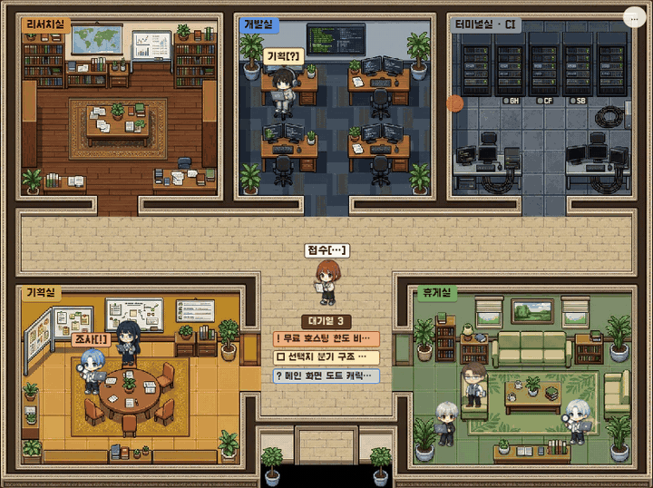
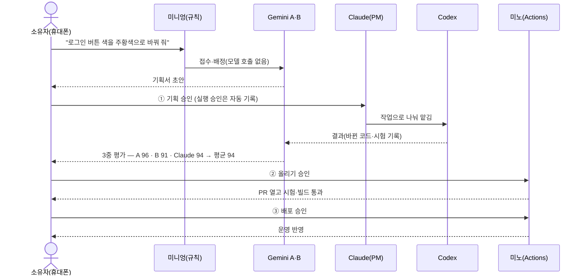
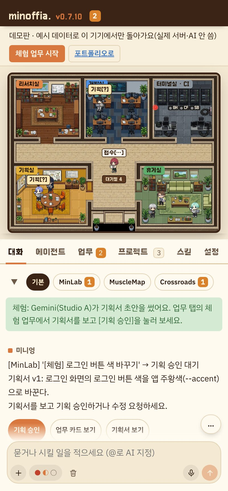
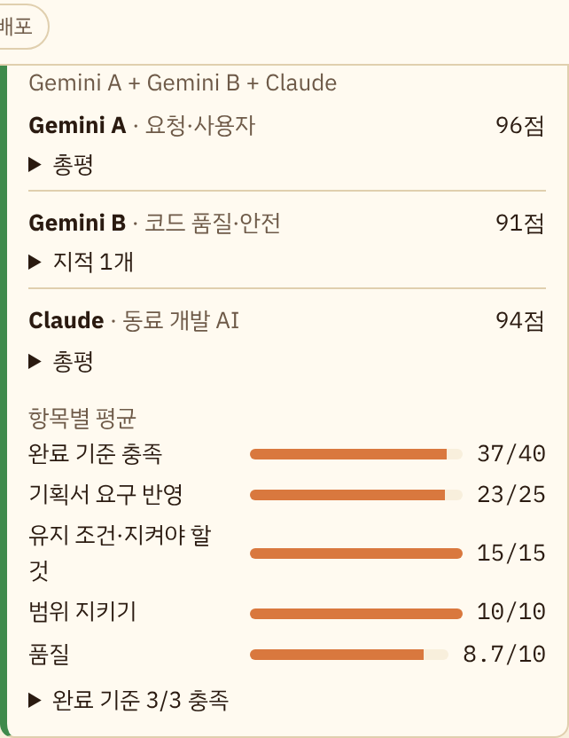
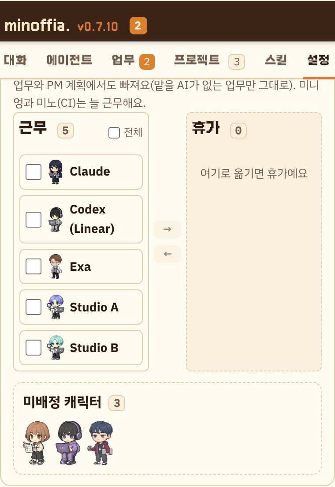

# 미노피아 (minoffia)

> 휴대폰으로 AI 개발팀을 지휘하는 1인 사무실. 사람은 요청하고 승인 세 번만 누르고, 기획·개발·채점·검사·배포는 역할을 나눈 AI들이 합니다.

**[포트폴리오 페이지](https://minlab-ai-office.pages.dev/portfolio)** · **[데모 직접 써 보기(로그인 없음)](https://minlab-ai-office.pages.dev/demo)**

데모판에서 녹화한 실제 화면입니다. 캐릭터 위치와 말풍선은 꾸며낸 움직임 없이 업무 상태만 따릅니다.

## 왜 만들었나

> "AI를 효율적으로 쓰고, 토큰을 아끼고, 더 고도화하고 싶었습니다."

AI가 여럿인데 사람이 그 사이를 오가며 글을 옮기고, 같은 설명을 몇 번씩 다시 하고, 결과가 맞는지 혼자 확인했습니다. 코딩을 몰라도 AI에게 일을 맡길 수는 있지만, **맡기는 방식**이 비효율이었습니다.

그래서 사람은 결정만 하고, 나머지는 AI끼리 나눠 하는 사무실을 만들었습니다. 코딩 지식 없이 16일 동안 만들었고, 추가 비용은 0원입니다.

## AI 팀원 소개

<table>
<tr>
<td align="center" width="14%"> <b>미니엉</b> 접수</td>
<td align="center" width="14%"> <b>Claude</b> PM·기획 + 보조 개발</td>
<td align="center" width="14%"> <b>Codex</b> 주 개발</td>
<td align="center" width="14%"> <b>Studio A</b> Gemini · 채점①</td>
<td align="center" width="14%"> <b>Studio B</b> Gemini · 채점②</td>
<td align="center" width="14%"> <b>Exa</b> 웹 조사</td>
<td align="center" width="14%"> <b>미노</b> 검수·배포</td>
</tr>
<tr>
<td valign="top">말을 받아 넘기고 승인을 알림. <b>규칙으로만</b> 움직여 토큰 0</td>
<td valign="top">요청을 기획서와 작업으로 나눔. Codex가 못 하면 대신 개발하고 PR을 엶</td>
<td valign="top">Linear로 업무를 받아 클라우드에서 개발·시험</td>
<td valign="top"><b>요청·사용자</b> 관점으로 채점, 질문 답. 무료 키 A</td>
<td valign="top"><b>코드 품질·안전</b> 관점으로 채점. 무료 키 B</td>
<td valign="top">웹에서 글을 찾아 오면 Gemini가 정리</td>
<td valign="top">GitHub Actions에서 검사·배포, 구조도·앱 지도</td>
</tr>
</table>

## 업무 하나 따라가기

데모판의 체험 업무("로그인 버튼 색 바꾸기") 하나가 지나가는 길입니다. 사람이 누르는 것은 굵은 화살표 세 번뿐입니다.

평균이나 과반이 80점 미만이면 사람에게 오기 전에 자동으로 다시 개발합니다. 승인·기획서·결과는 **고칠 수 없는 기록**으로 쌓이고, DB가 순서를 지킵니다.

| 대화로 요청 | 3중 평가 | AI 팀 근무·휴가 |
| --- | --- | --- |
|  |  |  |

## 결정 기록

코딩을 몰라도 판단은 제가 했습니다. 막히면 직접 시험해 보고 방향을 바꿨습니다.

| 문제 | 시도 | 결과 | 결정 |
| --- | --- | --- | --- |
| 무료 Gemini로 웹 검색 | 무료 키로 모델 24개를 직접 시험 | 모두 실패 | 검색은 Exa, 정리는 Gemini로 나눔. 안 될 땐 누를 때만 Claude |
| 지시서가 길어 토큰 낭비 | 늘 지킬 규칙을 각 저장소로 옮김 | 4,144자 → 909자 | 지시서에는 할 일만 |
| 결과가 맞는지 혼자 확인 | AI 하나로 채점 | 한 관점만 봄 | 같은 항목, 다른 관점 3중 평가 + 기준 미달은 자동 다시 개발 |
| "배정됨"과 "실행됨"이 섞임 | 상태를 화면에만 표시 | 확인 안 된 상태가 보임 | 확인한 상태와 출처만 표시, 승인 순서는 DB가 지킴 |
| 안 쓰이는 AI·기능 | 써 보며 기록 | Grok·"Gemini 쉬운 개발"은 한 번도 안 쓰임 | 뺌 |

그 밖에 AI가 꺼내 쓰는 작업 설명서(스킬) 13개를 11개 프로젝트에 넣었고, 배포할 때마다 버전 노트가 Obsidian 지식 그래프에 자동으로 쌓입니다.

## 바꾼 효과

| | 전 | 후 |
| --- | --- | --- |
| 지시서 길이 | 4,144자 | **909자** |
| 사람이 누르는 승인 | 기획·실행·올리기·배포 4번 | **3번** (실행 승인은 기획 승인에 포함해 자동 기록) |
| 채점 | AI 하나 | **AI 셋**(관점이 다른 Gemini 둘 + 동료 개발 AI) |
| 추가 비용 | — | **0원** |

## 16일 동안 쌓은 것

| 16일 | 397 | 224 | 3.1만 줄 | 500 | 29 | 56 | 14 | 0원 |
| :---: | :---: | :---: | :---: | :---: | :---: | :---: | :---: | :---: |
| 2026.10.29 → 11.13 | 합친 변경(PR) | 버전 기록 | 코드 | 자동 시험 | 서버 함수 | DB 변경 기록 | 관리하는 프로젝트 | 추가 비용 |

숫자는 저장소와 운영 DB 기록에서 센 값입니다(2026-11-13, [포트폴리오](https://minlab-ai-office.pages.dev/portfolio)와 같음). 앱 대부분은 Claude와 대화하며 만들었습니다. 앱 안에서 요청부터 배포까지 끝까지 돈 업무는 아직 3건이고, 지금도 실제로 쓰면서 검증하고 있습니다.

## 지켜 온 원칙

- **추가 결제 0원**: 이미 쓰는 구독과 무료 API만 씁니다. 유료 API·크레딧은 쓰지 않습니다.
- **비밀값은 서버에만**: 키는 서버 secrets에만 두고, 화면·로그·커밋에는 남기지 않습니다.
- **사람은 결정만**: 확인한 상태와 출처만 보여 주고, 승인과 결과는 고칠 수 없는 기록으로 남깁니다.

## 데모 직접 써 보기

[데모판](https://minlab-ai-office.pages.dev/demo)은 실제 앱 주소의 체험 모드입니다. 로그인 없이, 예시 데이터로 보는 기기 안에서만 돌아갑니다.

'체험 업무 시작'을 누르면 정해진 업무 하나가 생기고, AI·서버 몫(기획서 초안 → 개발 → 3중 평가 → PR 검사)은 브라우저 안에서 채워집니다. 소유자 몫인 승인 세 번만 직접 누르면 끝까지 갑니다. 실제 서버·AI는 부르지 않습니다.

## 앞으로

- 프로젝트별 채팅방(Discord처럼 AI가 직접 말하는 방)
- Gemini 두 개가 각각 시안을 그리고 서로 평가한 뒤 사람이 고르기
- 다른 사람도 쓸 수 있는 버전

## 기술 스택

| 영역 | 기술 |
| --- | --- |
| 화면 | React 18, TypeScript, Vite, PWA(휴대폰 홈 화면) |
| 서버 | Supabase(PostgreSQL, RLS, Auth, Realtime, Storage), Edge Functions(Deno) |
| AI 연결 | Claude Code 루틴, Codex(Linear), Gemini API 무료 키, Exa |
| 검사·배포 | GitHub Actions(타입 검사·시험·빌드·DB 시험·함수 배포), Cloudflare Pages |
| 시험 | Vitest, 로컬 PostgreSQL DB 시험, Playwright 화면 확인(휴대폰 400px·데스크톱 1400px) |

## 문서

| 문서 | 내용 |
| --- | --- |
| [설치·운영 안내](docs/SETUP.md) | 로컬 실행, Supabase·Claude 루틴·Cloudflare 연결 |
| [업무 흐름](docs/FLOW.md) | 승인 단계, 평가, 배포 |
| [구조](docs/ARCHITECTURE.md) | 화면·서버 함수·DB 구조 |
| [현재 상태](docs/STATUS.md) | 아직 안 된 것·검증 안 된 것 |
| [변경 기록](CHANGELOG.md) | 버전별 변경 |

---

[포트폴리오](https://minlab-ai-office.pages.dev/portfolio) · [데모](https://minlab-ai-office.pages.dev/demo) · [설치](docs/SETUP.md) · [흐름](docs/FLOW.md) · [구조](docs/ARCHITECTURE.md)
